# ひとりごと Android アプリ (M4〜M5)

Kotlin + Jetpack Compose。サーバーは [`../server`](../server/README.md)、仕様は [`../SPEC.md`](../SPEC.md)。
Android 8.0(API 26)以上。デバッグビルドだけ http(平文)でつなげる。リリースビルドは https のみ。

## 画面

| タイムライン | 処理中 | フォロワー | フォロワー詳細 |
|---|---|---|---|
| 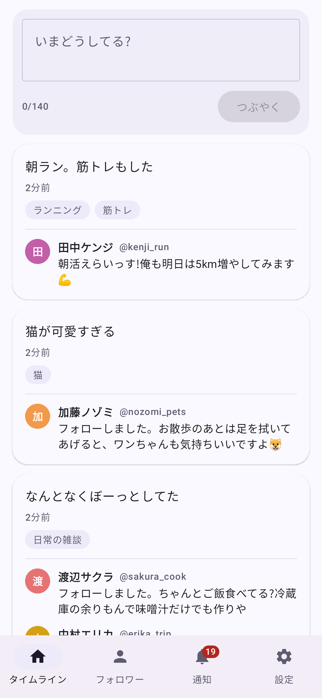 | 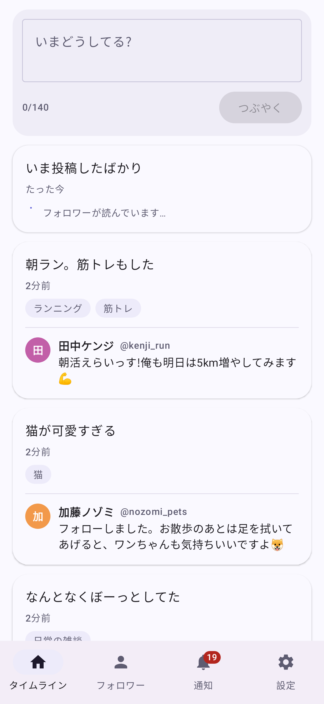 | 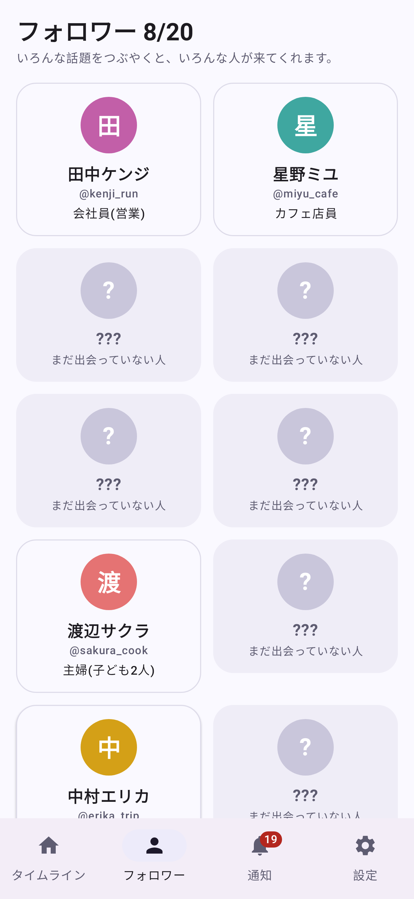 | 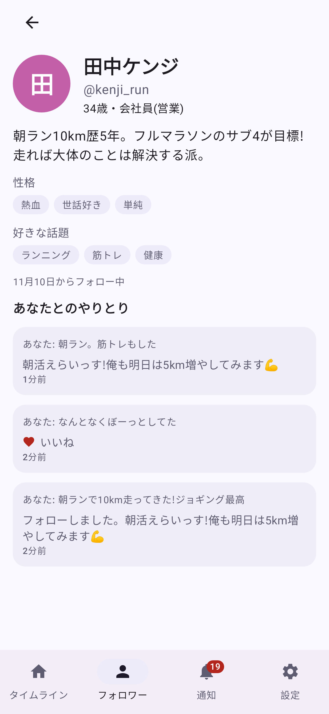 |

| 通知 | 設定 | ダーク | 登録 |
|---|---|---|---|
| 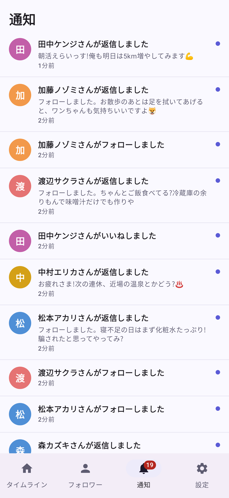 | 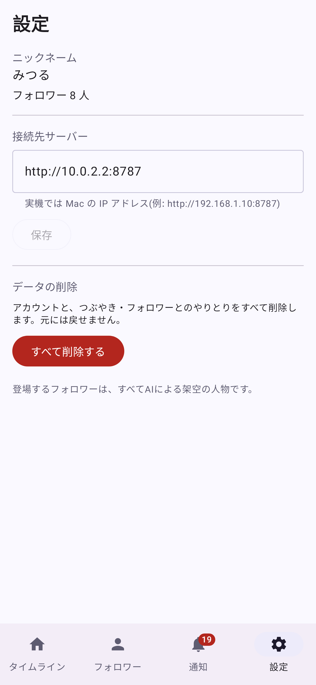 | 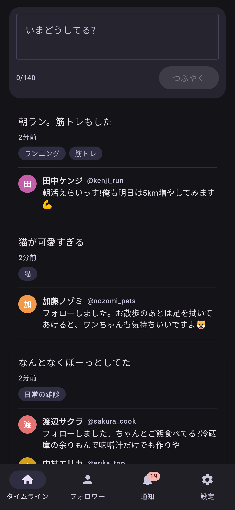 | 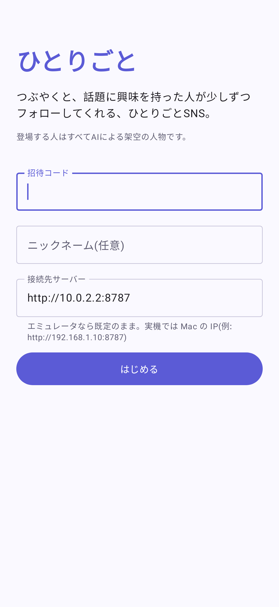 |

| 返信にいいね・会話へ | 会話画面 | 返事を待っている間 |
|---|---|---|
| 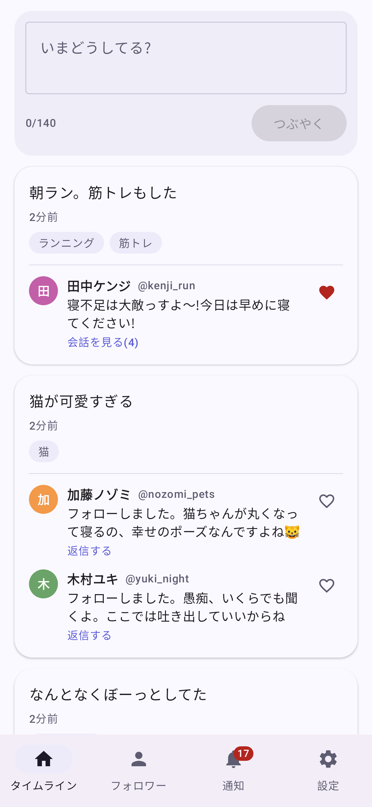 | 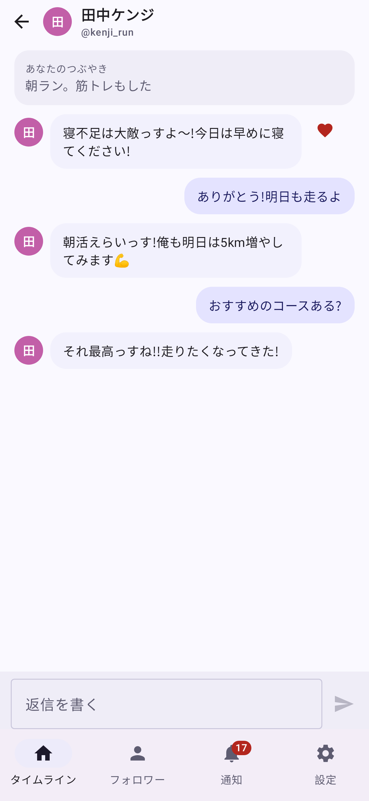 | 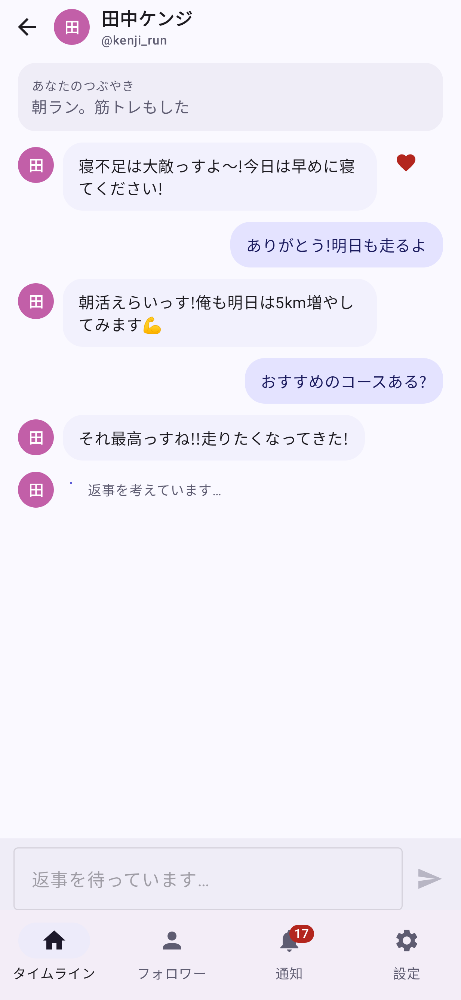 |

画像は、サーバーが実際に返したデータ(`app/src/test/resources/fixtures/`)を画面テストで描画したもの。

- **登録**: 招待コードを入れて匿名で登録(メールアドレス不要)。接続先サーバーも指定できる。
- **タイムライン**: つぶやく(140字)。投稿はすぐ反映され、フォロワーの反応は表示時刻になったものから現れる。処理中は「フォロワーが読んでいます…」。
- **フォロワーの返信へのいいね**: 返信の右のハートを押すといいね(もう一度押すと取り消し)。押した瞬間に画面へ反映し、サーバーが失敗したら元に戻す。
- **スレッド(会話)**: 返信をタップすると会話画面が開く。そこで返信を書くと、同じフォロワーが数秒〜30秒後に続きの返事をする(その間は「返事を考えています…」。返事待ちの間は次を送れない)。通知の「返信しました」をタップしても、その会話が開く。
- **フォロワー**: 20枠。まだ出会っていない人は「???」。タップで自己紹介・好きな話題・あなたとのやりとり。
- **通知**: 新規フォロー・いいね・返信。タブに未読数のバッジ。開くと既読になる。
- **設定**: 接続先の変更、データの全削除(確認ダイアログあり)。
- 画面が見えている間、サーバーに定期的に問い合わせる(反応が来そうな間は4秒おき、静かなときは15秒おき)。**プッシュ通知(FCM)は未実装。**

## Mac の Android Studio で動かす

1. Android Studio で **`ai-sns/android` フォルダ**を開く(Gradle の同期が走る)。
2. サーバーを起動する(別のターミナル)。
   ```sh
   cd ai-sns/server
   cp .dev.vars.example .dev.vars      # TOKEN_SECRET / ADMIN_KEY を設定。ローカルLLMを使うなら LLM_* も
   npm install && npm run db:local
   npm run dev:lan                     # 実機から見るなら 0.0.0.0 で待ち受ける
   ```
3. 招待コードを発行する。
   ```sh
   curl -s -X POST localhost:8787/admin/invites -H 'x-admin-key: <ADMIN_KEY>' \
     -H 'content-type: application/json' -d '{"maxUses":1}'
   ```
4. アプリを起動して、招待コードを入れる。
   - **エミュレータ**: 接続先は既定の `http://10.0.2.2:8787` のまま(`10.0.2.2` はエミュレータから見た Mac)。
   - **実機**: 接続先を `http://<MacのIPアドレス>:8787` にする(同じ Wi-Fi。IP は `ipconfig getifaddr en0`)。Mac のスリープは切っておく。

## ビルド・テスト

```sh
cd ai-sns/android
./gradlew testDebugUnitTest        # 83件(API・ViewModel・画面)。エミュレータ不要
./gradlew assembleDebug            # app/build/outputs/apk/debug/app-debug.apk
./gradlew testDebugUnitTest -Proborazzi.test.record=true   # 画面の画像を app/build/screens/ に出力
```

| テスト | 内容 |
|---|---|
| `ContractTest` | サーバーが実際に返したJSONを、アプリが読めること。サーバーのAPIを変えたら `fixtures/` を取り直す |
| `HttpSnsApiTest` | 通信(MockWebServer)。認証ヘッダ、エラーの扱い、接続できないとき |
| `ViewModelTest` | 取得・投稿・既読・削除・登録の動き。失敗時の扱い(削除に失敗したらログアウトしない など) |
| `LogicTest` | 相対時刻、問い合わせ間隔、通知の文言、140字判定(絵文字は1文字) |
| `ScreenTest` | Robolectric + Compose で、本物の画面を描画して操作。画像も出力 |

CI(`.github/workflows/build-hitorigoto-apk.yml`)が、push のたびにテストとビルドを行い、APK を成果物として保存する。

## 構成

```
app/src/main/java/com/hitorigoto/app/
  data/   Models(APIのJSON)/ SnsApi(OkHttp)/ SessionStore(DataStore。匿名のトークンと接続先だけを保存)
  ui/     Logic(純粋な関数)/ Components / AppRoot(登録⇄メインの切替)
  ui/register, ui/home   各画面とViewModel
```

画面は状態と操作を受け取るだけ(`HomeScreen(state, onPost, …)`)なので、ViewModel やサーバーなしで表示・テストできる。
